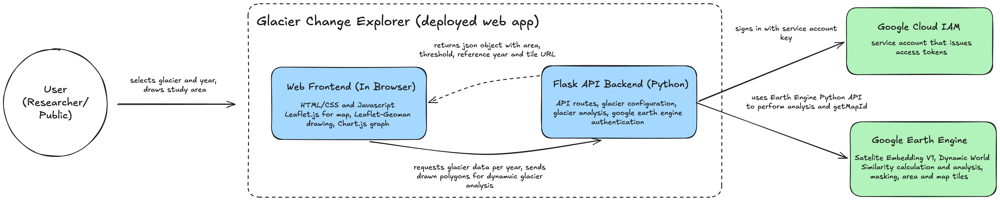
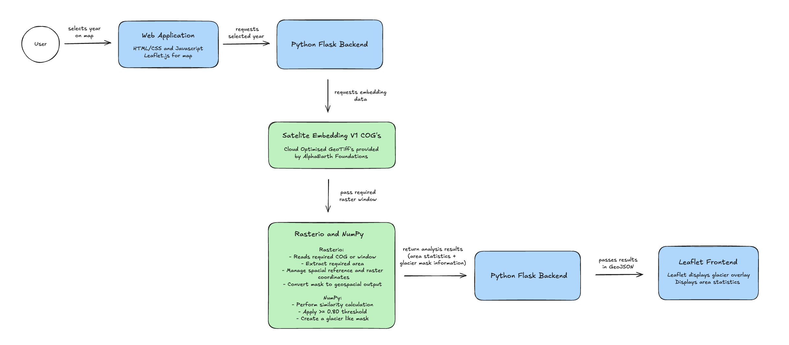

# Prototype Architecture

## 1. Overview

The Glacier Change Explorer is a prototype web application
designed to make changes in detected glacier-like areas easier to
visualise across multiple years. It started with Rob Roy Glacier and now
supports seven glaciers, configured in `backend/glaciers.py`, as well as
an experimental page where users can analyse an area they draw on the map.

Current architecture:

## 2. Why This Architecture Was Selected

Google Earth Engine was selected for the prototype because the existing
glacier analysis had already been developed by the applied science students and validated within Google Earth Engine.

Using the Google Earth Engine Python API allowed the existing methodology to be transferred to a web application without redesigning the underlying
analysis.

The prototype therefore focuses on demonstrating the user experience
and research concept rather than building a new geospatial processing
platform.

The Python implementation was validated against the original Earth
Engine implementation. For 2019, both implementations produced a
detected glacier-like area of approximately 10.71037 km².

## 3. Frontend

Leaflet is used to provide the interactive map interface.

The user can select a glacier and a year between 2017 and 2024. The
frontend requests the corresponding analysis from the Flask backend and
displays the returned Earth Engine map tiles.

Leaflet was selected because it provides a lightweight way to display
interactive geospatial layers without requiring a larger frontend
framework. It is also an open-source, free tool to use.

The frontend is plain HTML, CSS and JavaScript with no build step. It has
two pages, switched by URL hash:

- **Home / Explorer** (`#explorer`): glacier and year selection, the
  timeline slider and a side-by-side comparison of two years.
- **Experimental Explorer** (`#experimental`): the user draws a study area
  with **Leaflet-Geoman**, which is analysed with an automatic reference.

Both pages show a 2017–2024 area graph drawn with **Chart.js**. Results are
cached in the browser per glacier and year. The selected year loads first,
and the remaining years load in the background to fill in the graph.

## 4. Backend

Flask provides a small REST API between the frontend and Google Earth
Engine.

Endpoints:

- `GET /api/glacier/<year>?glacier=<id>`: standard analysis for a
  configured glacier.
- `POST /api/automatic-reference-analysis`: experimental analysis of a
  user-drawn GeoJSON area.
- `GET /health`: status check for the hosting platform.

Flask also serves the frontend files, so the application runs as a single
server.

For each analysis, the backend performs the Earth Engine analysis and returns:

- selected year
- reference year
- similarity threshold
- detected glacier-like area
- map tile URL

## 5. Google Earth Engine

Earth Engine currently performs the geospatial processing.

For each selected year, Satellite Embedding V1 data is compared against
a fixed glacier/snow reference derived from 2017.

A similarity threshold of 0.80 is applied to identify glacier-like
pixels, and the resulting area is calculated in square kilometres.

Using Earth Engine avoids downloading and locally processing the
underlying satellite embedding data during the prototype stage. For the
same reason, the application has no database: it stores no user data, and
all satellite data is retrieved from Earth Engine on demand.

For the experimental analysis, the 2017 reference is selected
automatically inside the user's drawn area instead of from hand-picked
polygons. A pixel is selected when it falls in:

- the top 25% of mean Dynamic World snow/ice probability during the local
  summer
- the top 30% of SRTM elevation
- slopes facing away from the sun

The summer dates and slope direction are chosen from the area's
hemisphere. This logic was developed on Rob Roy and is not reliable for
every glacier, so it is kept as a separate, clearly labelled experimental
feature.

## 6. Authentication and Deployment

The backend authenticates with Earth Engine using a Google Cloud
**service account**, implemented in `backend/ee_auth.py`. Previously,
each person running the backend had to sign in manually with
`ee.Authenticate()`. This only worked on that person's computer and could
not work on a deployed server.

The service-account key is supplied as the `EE_SERVICE_ACCOUNT_KEY`
environment variable and is never sent to the browser, so website users do
not need an Earth Engine account or login. Following least privilege, the
service account has only two roles:

- **Earth Engine Resource Viewer**, to read datasets and run analyses.
- **Service Usage Consumer**, to use the project's Earth Engine API and
  quota.

The browser loads overlay tiles directly from Earth Engine using the tile
URL returned by the backend. These URLs expire after a few hours.

The frontend and backend are deployed together on **Vercel**, with the
backend running as Python serverless functions and the key stored as a
Vercel environment variable.

## 7. Prototype Architecture Limitation

The current architecture depends on Google Earth Engine as the
processing backend.

This is suitable for demonstrating the prototype, but Earth Engine
service access and the Satellite Embedding dataset should be considered
separately when evaluating a future production or commercial system.

Serverless functions also have a maximum run time, which analyses of very
large glaciers or drawn areas can approach. The public API currently has
no rate limiting, so heavy use could exhaust the project's Earth Engine
quota.

## 8. Potential Production Architecture

### Commercial Considerations

Although Earth Engine is suitable for the prototype, the commercial viability of the architecture must also be considered.

Google provides Earth Engine access for eligible noncommercial projects, while commercial usage requires an appropriate commercial Earth Engine configuration. A commercial implementation would therefore need to consider Earth Engine pricing, compute usage, quotas and other infrastructure costs.

Google Earth Engine documentation:

- [Earth Engine access and project configuration](https://developers.google.com/earth-engine/guides/access)
- [Earth Engine commercial transition](https://developers.google.com/earth-engine/guides/transition_to_commercial)

---

### Alternative Architecture Without Earth Engine

Satellite Embedding V1 is not limited to Google Earth Engine.

The underlying **AlphaEarth Foundations Satellite Embedding dataset** is also distributed outside Earth Engine as **Cloud-Optimized GeoTIFFs (COGs)**. The dataset is licensed under **CC BY 4.0**, which permits commercial use subject to the licence's attribution and other requirements.

The external distribution contains annual embedding data that could therefore be accessed and processed directly by the application rather than through Earth Engine.

Relevant documentation:

- [Google AlphaEarth Foundations COG documentation](https://developers.google.com/earth-engine/guides/aef_on_gcs_readme)
- [Source Cooperative AlphaEarth Foundations distribution](https://source.coop/tge-labs/aef)
- [Creative Commons Attribution 4.0](https://creativecommons.org/licenses/by/4.0/)

### Cloud-Optimized GeoTIFFs

A **Cloud-Optimized GeoTIFF (COG)** is a geospatial raster format designed to allow applications to efficiently access portions of large raster datasets stored remotely.

This means the application would not necessarily need to download an entire embedding dataset to analyse a relatively small area such as Rob Roy Glacier.

The AlphaEarth Foundations COGs contain the **64 Satellite Embedding dimensions (A00–A63)** required by the current glacier similarity algorithm.

A geographic index provided with the dataset can be used to identify which COG intersects the requested study area.

---

### Potential Processing Pipeline

A future implementation could process the officially distributed
Satellite Embedding data outside Google Earth Engine.

Possible architecture:

---

**Rasterio** could be used to read the required geographic window and embedding bands from the COG while maintaining the raster's spatial information, including its coordinate reference system, transform and geographic extent.

The raster embedding values could then be represented as numerical arrays and processed using **NumPy**.

NumPy could reproduce the mathematical portion of the current Earth Engine algorithm:

1. Calculate the glacier reference embedding from the 2017 reference area.
2. Normalise the reference embedding.
3. Load the 64-dimensional embedding for the selected year.
4. Calculate similarity between each pixel and the reference embedding.
5. Apply the `>= 0.80` similarity threshold.
6. Produce a binary glacier-like mask.
7. Calculate the detected glacier-like area.

The resulting mask could then be converted into a web-compatible geospatial representation.

For a small prototype, this could be **GeoJSON**, which Leaflet can display directly. For a larger system, the resulting raster products could instead be stored and served as **map tiles or Cloud-Optimized GeoTIFFs**.
